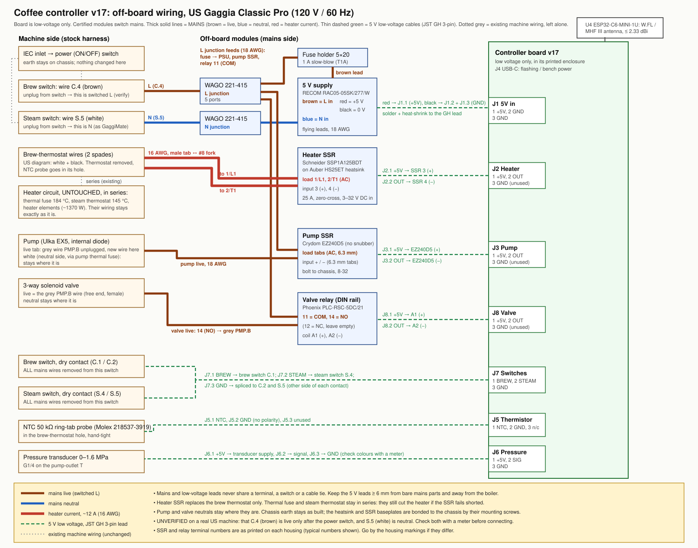

# Wiring: v18 low-voltage board + off-board modules (US Gaggia Classic Pro, 120 V)

This replaces INSTALL.md §5 for the v18 board. The board carries no mains: certified modules
switch the heater, pump and valve (parts and links are in [BUY.md](BUY.md)). INSTALL.md §4
(sensors, plumbing) and §6–§7 still apply.

> ⚠️ **Mains voltage.** Work with the machine unplugged, and cooled if it has been on. Photograph
> the stock wiring before you touch it. The thermal fuse and steam thermostat stay in series with
> the heater: they're the protection that doesn't depend on software. If you aren't comfortable
> with mains wiring, have this checked by an electrician before first power-on.

## Sources and confidence

- Machine wire names (C.4, S.5, PMP.B, BT, ST) and colours come from GaggiMate's Classic Pro guide,
  <https://docs.gaggimate.eu/docs/installation-gcp> (opened 2026-11-04), and its 100/120 V diagram
  "SIN035R 100/120V". On that US diagram:
  - the brew thermostat (107 °C) has a **white** and a **black** wire;
  - the steam thermostat (145 °C) has a **grey** and a **black** wire;
  - the thermal fuse is 184 °C;
  - the pump's two wires are **white** and **grey** (grey = PMP.B, the switched live);
  - the brew-switch line feed is **C.4 brown**, and the steam switch carries **S.5 white** and **S.4 black**.
- **US steam-switch difference** (GaggiMate, §4): *"On a US machine the double white will be on
  the other side. Follow the labeling and modifications of the switch positions regardless of
  that!"* So go by GaggiMate's position labels (S.1–S.5), not by where the white wires sit.
- GaggiMate's heater method differs from ours, but the circuit is equivalent:
  - **GaggiMate:** bridges the two brew-thermostat wires and puts its SSR in the steam-thermostat wires.
  - **This build:** puts the SSR in the brew-thermostat wires and leaves the steam thermostat and thermal fuse untouched.
- Items marked **UNSURE** are not confirmed for a US machine. Check each with a meter, machine unplugged.

## What changes in the machine

1. **Brew thermostat**
   - Unscrew it from the left side of the boiler.
   - Keep its two spade wires (white, black). They go to the heater SSR's load terminals, so the SSR takes the thermostat's place.
   - The NTC probe goes into the thermostat's M4 hole (INSTALL.md §4).
2. **Steam thermostat and thermal fuse:** leave them, and their wiring, exactly as they are.
3. **Switched live (L):** unplug **C.4 (brown)** from the brew switch. It becomes the live feed for everything we add. GaggiMate uses the same wire as its board's L.
   Confirm it **unplugged**, with the meter on Ω: the plug's **narrow blade (live)** to C.4 reads continuity with the power switch ON and open with it OFF. (The US plug is polarised, so this also proves the fuse below ends up in the live.)
4. **Neutral (N):** unplug **S.5 (white)** from the steam switch. It becomes the neutral feed for the 5 V supply. GaggiMate uses the same wire as its board's N.
   Confirm it unplugged: the plug's **wide blade (neutral)** to S.5 reads continuity, and S.5 to the earth pin reads open.
5. **Pump**
   - Unplug the **grey PMP.B** wire from the pump: the one that does *not* go to the pump's thermal fuse.
   - A new wire from the pump SSR goes onto that pump tab.
   - The pump's white wire stays where it is.
6. **Valve: identify its live wire before you park anything (step 7).**
   - Machine unplugged. With the meter on Ω, find the wire that reads through the valve coil to the valve's neutral: a few hundred Ω to a few kΩ.
   - In GaggiMate's build that is the free end of the grey **PMP.B** wire (it goes to their "V" output). On some machines the valve feed instead comes off a **brew-switch terminal**. If so, that switch wire is the valve live: **don't park it in step 7.**
   - Label it now. It goes to the valve SSR board's load terminal 2 (M9), through a male spade if it ends in a receptacle.
   - The valve neutral stays where it is.
   - If no wire shows the coil's resistance, stop: don't guess. Photograph the harness and trace the valve's two wires back from the valve body.
7. **Brew and steam switches** (after step 6)
   - Remove every mains wire from both switches, **except** that you already took the valve live labelled in step 6 to the valve SSR.
   - Insulate each freed end (they already have insulated receptacles; add heat-shrink over any that don't) and tie them back.
   - The switches then carry only the 5 V J7 signals, and the switch lamps go dark.
   - GaggiMate moves S.4 (black) to the S.1 position. In this build S.4 is parked insulated, **not** moved, because the steam switch must not bypass anything: the board owns the heater.
   - **UNSURE:** whether S.4 is part of the steam-thermostat path on a US machine. If parking it breaks the heater circuit, the heater simply won't heat (fail-safe), and the "heater circuit" check below catches it.

## Terminal-by-terminal table

### Mains side

As GaggiMate's Lego build: **18 AWG silicone** for every mains run, **6.35 mm** spade
quick-connects onto the machine's tabs, **forks** on the heater SSR's screw terminals, joins
**twisted, soldered and heat-shrunk** (BUY.md).

| # | From | To | Ends | Notes |
|---|---|---|---|---|
| M1 | C.4 brown (female receptacle, ex brew switch) | **L splice** | male spade ← C.4 / three-way splice: twist the pigtail with branches M2, M6, M8, solder, heat-shrink | Switched L for everything we add |
| M2 | L splice | 5 V supply **L / AC in** | — / screw terminal, or solder + heat-shrink on a pin-type module | |
| M4 | S.5 white (female receptacle, ex steam switch) | 5 V supply **N / AC in** | male spade ← S.5 / as M2 | Neutral |
| M6 | L splice | **pump** SSR board, load terminal 1 | — / screw terminal | |
| M7 | pump SSR board, load terminal 2 | pump live tab (where grey PMP.B was) | screw terminal / female spade | |
| M8 | L splice | **valve** SSR board, load terminal 1 | — / screw terminal | |
| M9 | valve SSR board, load terminal 2 | grey PMP.B free end (female receptacle) | screw terminal / male spade | Valve live |
| M9s | **snubber** | across the valve SSR board's two load terminals | in the same screw terminals | Lets the SSR switch the small valve load off cleanly |
| M10 | brew-thermostat wire 1 (white, female) | heater SSR **1/L1** | male spade / fork | The SSR replaces the thermostat |
| M11 | brew-thermostat wire 2 (black, female) | heater SSR **2/T1** | male spade / fork | |
| — | pump white, valve neutral, steam thermostat, thermal fuse, heater, earth | unchanged | — | Don't touch |

Mechanical (as GaggiMate):
- **Heater SSR:** flat on the inside of the rear panel at the ventilation slots, two M4 bolts with nuts and washers through the slots (or cable ties through them); its factory thermal pad against the panel. Clip its clear terminal cover on.
- **SSR boards and 5 V supply:** their undersides carry mains: mount them on a plastic part (the printed holder, or cable-tied to a plastic bracket), never directly against the steel case. Keep them away from the boiler.
- **Joints on the brew-thermostat wires (M10/M11):** pull them away from the boiler before tying them down; tape or heat-shrink any bare metal.
- **Parked switch wires:** insulate each freed end (tape or heat-shrink) and tie it back; GaggiMate notes some machines have monoblock connectors whose receptacles come out bare.

### Low-voltage side

Every board connector is a JST **GH** 1.25 mm 3-pin side-entry header (SM03B-GHS-TB). Every cable is a pre-crimped JST GH 3-pin lead, about 300 mm, with the far end stripped (BUY.md #9).

#### Joining the GH leads

GH leads are thin (28 AWG), so join them by soldering, not in screw clamps: twist each to a short
18 AWG pigtail (about 80 mm), solder, heat-shrink, and cable-tie the joint so it can't flex.
The pigtail then goes into the module's screw terminal or gets a spade. The supply's output,
the thermistor and the transducer are soldered directly. Tug-test every joint.

| Board pin | Signal | Goes to | Notes |
|---|---|---|---|
| J1.1 | +5 V in | 5 V supply **+V out** | Solder + heat-shrink |
| J1.2 | GND | 5 V supply **−V / GND out** | |
| J1.3 | GND | 5 V supply GND too | Two thin wires halve the ground-return resistance |
| J2.1 | +5 V | heater SSR **3 (+)** input | 18 AWG pigtail in the screw clamp |
| J2.2 | OUT (pulled low = ON) | heater SSR **4 (−)** input | |
| J2.3 | GND | — | Unused. Cut back and insulate |
| J3.1 | +5 V | **pump** SSR board **VCC** *and* **IN** | Tie VCC and IN together on the board: the board is then on whenever J3 switches its GND |
| J3.2 | OUT (pulled low = ON) | pump SSR board **GND** | |
| J3.3 | GND | — | Unused |
| J8.1 | +5 V | **valve** SSR board **VCC** *and* **IN** | as J3 |
| J8.2 | OUT | valve SSR board **GND** | |
| J8.3 | GND | — | Unused |
| J7.1 | BREW | brew switch, terminal **C.1** | Female spade on an 18 AWG pigtail |
| J7.2 | STEAM | steam switch, terminal **S.4** | |
| J7.3 | GND | brew switch **C.2** *and* steam switch **S.5** | Splice the one GND lead into two short tails (solder + heat-shrink). C.1/C.2 and S.4/S.5 are the pole positions GaggiMate uses for its LV button wires; **UNSURE** for your switch: check with a meter that each pair closes when its switch is pressed |
| J5.1 | NTC | Molex 218537-3919 lead (PTFE, 28 AWG) | No polarity. Solder + heat-shrink, with the joint well away from the boiler (the probe's 300 mm leads reach). The firmware defaults are this probe's (Steinhart-Hart from Molex's table, BUY.md §10a) |
| J5.2 | GND | thermistor lead | |
| J5.3 | — | — | Unused |
| J6.1 | +5 V | transducer supply wire | GaggiMate's 0–1.6 MPa sensor has no datasheet: identify its wires on the bench first (INSTALL §3) |
| J6.2 | signal | transducer output wire | ~0.5 V at 0 bar |
| J6.3 | GND | transducer ground wire | Solder + heat-shrink each splice |
| J4 | USB-C | flashing / bench power | **USB and J1 may be connected at the same time.** The board feeds VBUS in through a Schottky diode (D2) and J1 through a P-MOSFET. With both connected, the 5 V module supplies the board and nothing back-feeds the PC. With the case open, still flash and bench-test with the machine unplugged |
| U4 | W.FL / MHF III | Taoglas CAB.A02 pigtail (MHF III → SMA bulkhead) + Taoglas GW.15.2113 2 dBi SMA dipole (BUY.md §11) | Mount the SMA bulkhead in a **plastic** part: on the steel case the dipole's gain can exceed the module's 2.33 dBi limit (Taoglas plots). Press the MHF III plug straight down onto the socket; don't force it |

## Checks before mains (multimeter, machine unplugged)

1. **Supply input:** across the 5 V supply's L and N inputs, expect a high reading (several kΩ or more), not a short.
2. **Heater SSR open:** the 1/L1–2/T1 load terminals read open or very high on the Ω range.
3. **Heater circuit intact:** with the **machine's power switch ON** (still unplugged), temporarily short the two brew-thermostat wires (SSR out of circuit). From C.4 through the heater to neutral you should now read the heater's ~10 Ω. Remove the short afterwards. If it reads open, a parked wire (e.g. S.4) was part of the heater path. Stop and re-check against GaggiMate's diagram before going further.
3b. **Steam thermostat in series with the SSR:** with the short from check 3 still on (reading ~10 Ω), unplug **one** steam-thermostat lead: the reading must go **open**. If it stays at ~10 Ω, **stop**: the steam thermostat isn't in the SSR's heater path, so don't power on until it is. Plug it back and confirm ~10 Ω again. This proves the 145 °C thermostat still guards the heater path the SSR switches.
4. **SSRs open:** each SSR board's load terminals read open or very high (with the snubber across the valve board you'll read its resistor, typically ~100 Ω: that's fine).
4a. **Pump and valve still connected after the switch wires were parked** (step 7), measured to S.5 with the power switch ON:
   - the pump SSR board's load terminal 2 (M7) through the pump reads its coil. The Ulka has a diode in series, so use diode mode or try both lead polarities before calling it open;
   - the valve SSR board's load terminal 2 (M9) through the valve coil reads a few hundred Ω to a few kΩ.
   An open reading means a parked wire was part of that path. **Look** that the pump's thermal fuse is back in its clip if the plumbing step took it out (a loose fuse still conducts).
5. **Isolation:** no continuity from any mains wire or SSR load terminal to:
   - J1–J8 pins;
   - the 5 V supply's output terminals;
   - the switch dry contacts.
   No continuity from any mains wire to the chassis.
6. **Earth:** touch the meter leads together first and subtract that reading. Chassis to the plug's earth pin < 0.5 Ω, and **the heater SSR's metal base** to the earth pin < 0.5 Ω (through its M4 bolts: scrape paint under them if it reads high).
7. **Switches:** J7.1–J7.3 closes when brew is pressed; J7.2–J7.3 closes when steam is pressed.
8. **Thermistor** (do this before INSTALL §4 fits it): **~50 kΩ** between its two leads at 25 °C (Molex 218537-3919: 50 kΩ ± 1 %; about 63 kΩ at 20 °C), and **open (> 20 MΩ, the meter's top range)** from either lead to the M4 screw body. If either lead shows continuity to the body, don't use it: the boiler is earthed, so that would ground the NTC input.

9. **After the case goes back together:** every earth wire you unplugged is back on. GaggiMate's install guide warns that the top cover (cup warmer) has **two** earth wires. Measure each panel, the top cover included, to the plug's earth pin: < 0.5 Ω.

## First power-on

Follow INSTALL.md §6:
1. The board boots from the 5 V supply. The firmware heats from boot: the UI shows the heater on and the power meter reads ~1.37 kW.
2. A flush (UI or `coffee flush`) runs the pump and opens the valve together: you hear the pump and see water at the group. There is no heater-only or pump-only command.
3. Listen for pump hum while the pump is "off". The G3MB-202P leaks at most about 1 mA, far below what moves the pump; a hum means something is bypassing the SSR.
